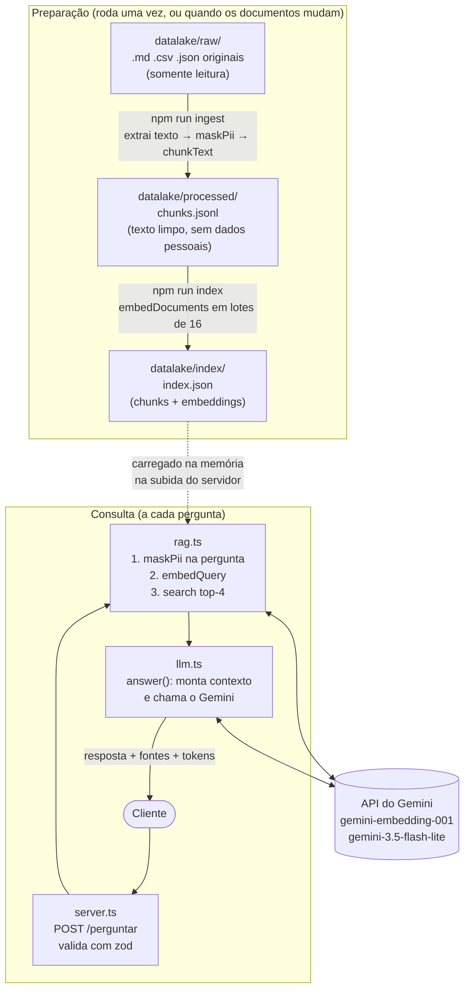

# Assistente de Políticas da Loja

API em Node.js/TypeScript que responde perguntas de clientes de uma loja online fictícia usando **somente** os documentos da loja (política de troca, frete, garantia, FAQ e tickets de atendimento).

Ela usa **RAG** (*Retrieval-Augmented Generation*): primeiro busca os trechos dos documentos mais parecidos com a pergunta e depois pede ao Gemini que responda **só** com base nesses trechos, citando a fonte. Se a resposta não estiver nos documentos, o assistente diz isso em vez de inventar.

Projeto de estudo: código simples, sem banco vetorial e sem frameworks de IA, para deixar cada etapa visível.

## Sumário

- [Como funciona](#como-funciona)
- [Como rodar](#como-rodar)
- [Exemplo de requisição e resposta](#exemplo-de-requisição-e-resposta)
- [Avaliação](#avaliação)
- [Estrutura do projeto](#estrutura-do-projeto)
- [Decisões de projeto](#decisões-de-projeto)
- [Limitações](#limitações)
- [Próximos passos](#próximos-passos)

## Como funciona



O data lake tem três camadas:

| Camada | Conteúdo | No Git? |
| --- | --- | --- |
| `raw/` | Documentos originais. **Nunca** são editados nem apagados. | Sim |
| `processed/` | `chunks.jsonl`: um pedaço de texto por linha, já com CPF, e-mail e telefone mascarados. | Sim |
| `index/` | `index.json`: os chunks com seus vetores (embeddings). Pode ser recriado a qualquer momento. | Não |

Passo a passo de uma pergunta:

1. **Validação:** a pergunta precisa ter de 3 a 500 caracteres (depois de tirar espaços das pontas).
2. **Mascaramento:** CPF, e-mail e telefone viram `[CPF]`, `[EMAIL]` e `[TELEFONE]` **antes** de qualquer envio ao Gemini.
3. **Embedding:** a pergunta vira um vetor de 768 números (`gemini-embedding-001`).
4. **Busca:** o vetor é comparado com todos os chunks do índice por similaridade de cosseno; os 4 mais parecidos são escolhidos.
5. **Resposta:** os 4 trechos vão para o Gemini dentro de `<contexto>`, com um system prompt que manda responder só com base neles e citar o trecho usado (`[1]`, `[2]`...).

## Como rodar

### Pré-requisitos

- [Node.js](https://nodejs.org/) **20.6 ou mais novo** (testado no Node 24). Confira com `node --version`.
- Uma chave da API do Gemini, gerada de graça no [Google AI Studio](https://aistudio.google.com/apikey).

> **Atenção:** no plano gratuito, o Google pode usar o conteúdo enviado para melhorar os produtos dele. Por isso os documentos deste projeto são fictícios. Não coloque dados reais.

### 1. Instalar as dependências

```bash
npm install
```

O npm pode avisar que bloqueou scripts de pós-instalação (`esbuild`, `protobufjs`). Pode ignorar: o projeto funciona sem eles.

### 2. Configurar a chave

Copie o arquivo de exemplo e cole sua chave no lugar de `cole-sua-chave-aqui`:

```bash
cp .env.example .env          # Linux/macOS/Git Bash
copy .env.example .env        # CMD ou PowerShell no Windows
```

```dotenv
GEMINI_API_KEY=sua-chave-aqui
GEMINI_MODEL=gemini-3.5-flash-lite
```

O `.env` está no `.gitignore`: ele nunca deve ir para o Git.

### 3. Conferir que está tudo certo (opcional)

```bash
npm run typecheck   # checagem de tipos do TypeScript
npm test            # testes de chunking e mascaramento (não usa a API)
```

### 4. Preparar os documentos

```bash
npm run ingest      # raw/ -> processed/chunks.jsonl   (não usa a API)
npm run index       # processed/ -> index/index.json   (usa a API de embeddings)
```

Saída esperada:

```text
5 arquivos -> 6 chunks
Lote 1: 6/6 chunks
Índice salvo em datalake/index/index.json (6 chunks)
```

Sempre que mudar algo em `datalake/raw/`, rode os dois comandos de novo.

### 5. Subir a API

```bash
npm run dev
```

A API fica em `http://localhost:3000`. Deixe esse terminal aberto e use outro para fazer as perguntas.

### 6. Fazer uma pergunta

Bash (Linux, macOS ou Git Bash):

```bash
curl -s localhost:3000/perguntar -H "content-type: application/json" \
  -d '{"pergunta":"Em quantos dias posso trocar um produto?"}'
```

PowerShell (no Windows PowerShell 5.1, `curl` é outro comando, por isso usamos `Invoke-RestMethod`):

```powershell
Invoke-RestMethod -Method Post -Uri http://localhost:3000/perguntar `
  -ContentType "application/json; charset=utf-8" `
  -Body '{"pergunta":"Em quantos dias posso trocar um produto?"}' | ConvertTo-Json -Depth 5
```

Para ver se a API está no ar: `GET http://localhost:3000/saude` devolve `{"ok":true}`.

### Problemas comuns

| Sintoma | Causa provável | Solução |
| --- | --- | --- |
| `npm run index` mostra `Erro: ModelError: Falha ao chamar o modelo (status 400)` | Chave inválida ou ainda com o texto de exemplo | Confira `GEMINI_API_KEY` no `.env` |
| `status 403` | A chave não tem acesso à API do Gemini | Gere outra chave no AI Studio |
| `status 429` ou API respondendo `503` | Limite por minuto ou cota diária do plano gratuito | Espere; a mensagem do Gemini diz quando a cota volta |
| `status 503`, ou a API responde `502` depois de ~60 s | Modelo sobrecarregado no Google | Tente mais tarde |
| `npm run dev` termina com `Índice não encontrado` | Faltou rodar o passo 4 | `npm run ingest` e `npm run index` |
| `EADDRINUSE` ao subir a API | A porta 3000 já está em uso (outra instância aberta?) | Feche o outro processo ou o terminal antigo |
| `node: bad option: --env-file` | Node mais antigo que 20.6 | Atualize o Node |

### Todos os comandos

| Comando | O que faz | Usa a API? |
| --- | --- | --- |
| `npm run ingest` | `raw/` → `processed/chunks.jsonl` | Não |
| `npm run index` | `processed/` → `index/index.json` | Sim (embeddings) |
| `npm run dev` | Sobe a API em `localhost:3000` | Sim |
| `npm run eval` | Roda as 10 perguntas de `eval/perguntas.json` | Sim |
| `npm run typecheck` | `tsc --noEmit` | Não |
| `npm test` | Testes com vitest | Não |

## Exemplo de requisição e resposta

Requisição:

```http
POST /perguntar
content-type: application/json

{ "pergunta": "Em quantos dias posso trocar um produto?" }
```

Resposta `200`:

```json
{
  "resposta": "Você pode solicitar a troca de um produto em até **30 dias corridos** contados a partir da data de recebimento do pedido [1].",
  "fontes": [
    { "trecho": 1, "arquivo": "politica-troca.md", "score": 0.771 },
    { "trecho": 2, "arquivo": "garantia.md", "score": 0.716 },
    { "trecho": 3, "arquivo": "politica-troca.md", "score": 0.709 },
    { "trecho": 4, "arquivo": "tickets.json", "score": 0.705 }
  ],
  "uso": { "entrada": 1587, "saida": 31, "total": 1618 }
}
```

- `fontes`: os 4 trechos enviados ao modelo. O número em `[1]` na resposta é o `trecho`. `score` é a similaridade de cosseno com a pergunta (quanto maior, mais parecido).
- `uso`: tokens de entrada, de saída e o total (que inclui o "raciocínio" do modelo; é o número que importa para custo).

Pergunta sem resposta nos documentos:

```json
{ "pergunta": "Vocês aceitam gift card?" }
```

```json
{ "resposta": "Não encontrei essa informação nos documentos da loja.", "fontes": [ ... ], "uso": { ... } }
```

### Erros

As mensagens de erro nunca expõem detalhes internos nem a chave.

| Situação | Status | Corpo |
| --- | --- | --- |
| Pergunta com menos de 3 ou mais de 500 caracteres, ou sem o campo `pergunta` | 400 | `{ "erro": "Envie { pergunta } com 3 a 500 caracteres." }` |
| JSON malformado | 400 | `{ "erro": "Requisição inválida." }` |
| Limite ou cota da API do Gemini (429) | 503 + `retry-after: 30` | `{ "erro": "Muitas requisições. Tente novamente em instantes." }` |
| Outra falha do Gemini (ex.: chave inválida) | 502 | `{ "erro": "Falha ao consultar o modelo." }` |
| Erro inesperado | 500 | `{ "erro": "Erro interno." }` |

### Logs

O texto da pergunta **nunca** é logado. Após cada resposta, a API loga só tokens e arquivos usados:

```json
{"level":30,"tokens":{"entrada":1587,"saida":31,"total":1618},"arquivos":["politica-troca.md","garantia.md","tickets.json"],"msg":"pergunta respondida"}
```

## Avaliação

`npm run eval` passa as 10 perguntas de [`eval/perguntas.json`](eval/perguntas.json) pelo fluxo completo (busca + Gemini):

- **8 perguntas com resposta nos documentos:** acerta se a resposta contém o trecho esperado (ex.: `"30 dias"`, `"19,90"`), sem diferenciar maiúsculas.
- **2 perguntas sem resposta** (gift card e loja física, que ficaram de fora dos documentos de propósito): acerta se a resposta contém "não encontrei".

| Modelo | Com resposta (meta 7+/8) | Recusas corretas (meta 2/2) | Total | Tokens médios |
| --- | --- | --- | --- | --- |
| `gemini-3.5-flash-lite` | 8/8 | 2/2 | 10/10 | 1675 |

Rodado em 5/11/2026.

**Por que só um modelo?** O plano previa comparar com o `gemini-3.8-flash`, mas a comparação virou opcional:

- o `flash-lite` já passou das metas (10/10), e é o modelo mais barato e mais rápido (1 a 2 s por pergunta);
- trocar de modelo é o **último** passo quando uma pergunta falha (depois de ajustar chunks, `k` e prompt), e nenhuma falhou;
- no plano gratuito, o `gemini-3.8-flash` tinha cota de 20 requisições/dia e ficou indisponível por sobrecarga (erro 503 e chamadas sem resposta) nas tentativas de 5 e 6/11/2026.

Para comparar com outro modelo mesmo assim:

```bash
GEMINI_MODEL=gemini-3.8-flash npm run eval                       # Bash
$env:GEMINI_MODEL="gemini-3.8-flash"; npm run eval               # PowerShell (vale até fechar o terminal)
```

Se uma pergunta falhar, o `eval` mostra as fontes usadas. Investigue nesta ordem: o chunk certo veio no top-4? Ajuste o tamanho do chunk, a sobreposição e `k`. Depois o system prompt. Só então teste outro modelo.

## Estrutura do projeto

```text
datalake/
  raw/              documentos originais (fictícios)
  processed/        chunks.jsonl
  index/            index.json (gerado, fora do Git)
eval/
  perguntas.json    casos da avaliação
src/
  types.ts          interface Chunk
  chunk.ts          chunkText(): quebra o texto em pedaços com sobreposição
  pii.ts            maskPii(): mascara CPF, e-mail e telefone
  retry.ts          withRetry() e ModelError
  ingest.ts         raw/ -> processed/
  embeddings.ts     embedDocuments(), embedQuery()      (fala com o Gemini)
  store.ts          saveIndex(), loadIndex(), search()
  build-index.ts    processed/ -> index/
  llm.ts            answer(): gera a resposta             (fala com o Gemini)
  rag.ts            ask(): máscara + embedding + busca + resposta
  server.ts         API Fastify
  eval.ts           avaliação
tests/
  chunk.test.ts
  pii.test.ts
```

Só `embeddings.ts` e `llm.ts` falam com o Gemini. Trocar de provedor de IA exige mexer só nesses dois arquivos.

## Decisões de projeto

- **Sem banco vetorial.** Com poucos chunks, um JSON e uma busca comparando a pergunta com todos os vetores ("força bruta") é rápido e fácil de entender.
- **Vetores normalizados (norma 1).** Assim o produto escalar já é a similaridade de cosseno, e a busca fica uma multiplicação simples.
- **Chunks de ~1.800 caracteres (~500 tokens) com 200 de sobreposição.** O corte tenta cair no fim de um parágrafo; a sobreposição evita que uma regra dividida entre dois chunks se perca.
- **Dados pessoais mascarados duas vezes:** na ingestão (nada com CPF/e-mail/telefone chega a `processed/`) e na pergunta do usuário (antes de ir para o Gemini).
- **Uma única camada de retry.** O `withRetry()` repete em 429 (limite por minuto), 500 e 503, esperando 1 s, 2 s e 4 s. O retry interno do SDK fica desligado para as esperas não se somarem. 429 de **cota diária** não é repetido, porque a cota só volta em horas.
- **Limite de 60 s por chamada de texto.** Quando o modelo está sobrecarregado, a chamada às vezes fica sem resposta em vez de dar erro. Com o limite, ela falha em 60 s e a API responde 502, em vez de deixar o cliente esperando para sempre.
- **`store: false`.** A Interactions API guarda as conversas no servidor por padrão; como não usamos histórico, isso fica desligado.
- **Frase fixa para "não sei".** O system prompt manda responder exatamente "Não encontrei essa informação nos documentos da loja.", o que permite verificar recusas automaticamente na avaliação.

## Limitações

- **Mascaramento por regex.** `maskPii()` pega CPF, e-mail e telefone em formatos comuns, mas não pega nomes, endereços, RG, cartões ou dados escritos de forma diferente. Também pode mascarar por engano um número de 11 dígitos que não é CPF.
- **Sempre envia 4 trechos.** Não há nota mínima de similaridade: mesmo quando nenhum trecho é relevante, os 4 mais parecidos vão para o modelo, e quem decide recusar é o Gemini.
- **Avaliação simples.** Só 10 perguntas, conferidas por substring: uma resposta certa escrita de outro jeito ("três tentativas" em vez de "3 tentativas") conta como erro, e uma resposta errada que contenha o trecho conta como acerto.
- **Sem histórico.** Cada pergunta é independente; o assistente não lembra da anterior.
- **Índice todo na memória.** Funciona para poucos milhares de chunks; para muito mais, seria preciso um banco vetorial.
- **Atualização manual.** Mudou um documento? É preciso rodar `ingest` e `index` de novo e reiniciar a API.
- **Sem limite de requisições na API.** Um cliente pode esgotar a cota do Gemini (que no plano gratuito é baixa).
- **Plano gratuito do Gemini.** Cotas pequenas (o `gemini-3.8-flash` permitia 20 requisições/dia), modelos que às vezes ficam sobrecarregados e uso dos dados enviados pelo Google.
- **Um modelo avaliado.** Só o `gemini-3.5-flash-lite` passou pela avaliação; não sabemos quanto um modelo maior melhoraria (ou não) as respostas.

## Próximos passos

- Respostas em streaming (SSE) para o texto aparecer aos poucos.
- Histórico de conversa com `previous_interaction_id`.
- *Context caching* do system prompt e do contexto para reduzir custo.
- Rota `POST /ingestao` para atualizar os documentos sem reiniciar.
- Banco vetorial (pgvector) e armazenamento de objetos (MinIO/S3) para o data lake.
- Filtro por metadados (ex.: buscar só em `frete.md`).
- Limite de requisições por cliente com `@fastify/rate-limit`.
- Docker para subir tudo com um comando.
- Usar o Gemini como juiz na avaliação, para aceitar respostas certas escritas de outro jeito.
- Nota mínima de similaridade para recusar sem nem chamar o modelo.
